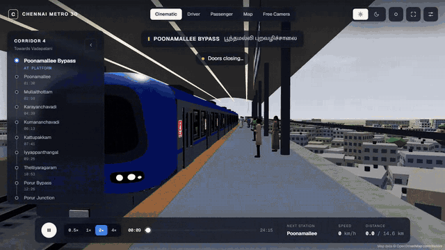
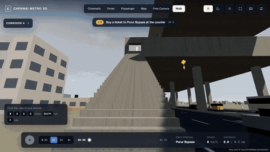

<div align="center">

# Chennai Metro 3D

**Ride all five Chennai Metro lines in real-time 3D, on the real track, through the real city.**

[](https://madesh-ops.github.io/chennai-metro-3d/) [](https://github.com/madesh-ops/chennai-metro-3d/actions/workflows/pages.yml) [](LICENSE) [](https://github.com/madesh-ops/chennai-metro-3d/stargazers)

[**Open the live site**](https://madesh-ops.github.io/chennai-metro-3d/) · [Features](#features) · [Walk mode](#walk-mode) · [Run it](#run-it) · [How it works](#how-it-works) · [Data](#data) · [Contributing](#contributing)

<br>

[](docs/media/showcase.mp4)

<sub>▶ <a href="docs/media/showcase.mp4">Full recording (1 min, MP4)</a></sub>

</div>

Pick a line and any two stations. Walk in from the street, buy a ticket, go through the gates and up to the platform, then ride a three-car train as it departs, accelerates, cruises, brakes into each platform and opens its doors. Watch from five cameras, by day or night, in sun or rain. Or just ride.

## Lines

| | Route | Status |
| :-: | --- | --- |
| 🔵 1 | Wimco Nagar Depot → Chennai Airport | Open |
| 🟢 2 | Chennai Central → St. Thomas Mount | Open |
| 🟡 4 | Poonamallee Bypass → Vadapalani | Open since 11 Oct 2026 (six Arcot Road stations not open yet) |
| 🟣 3 | Madhavaram Milk Colony → SIPCOT | Under construction: preview ride |
| 🟡 4 | Vadapalani → Lighthouse | Under construction: preview ride |
| 🔴 5 | Madhavaram Milk Colony → Sholinganallur | Under construction: preview ride |

Previews run on the real track; every station is a stop and the timings are illustrative.

## Features

- **Real track, real city.**
  - Every line follows its real path from OpenStreetMap: up on viaducts, down ramps into tunnels and underground stations.
  - Around it are the real streets, buildings, flyovers, lakes and parks.
- **Five cameras and a walk:**
  - **Cinematic:** an automatic shot director (chase, front three-quarter, fly-by, side, aerial, platform arrival).
  - **Driver:** from the cab, behind the console.
  - **Passenger:** a seat, the doors or the car end.
  - **Map:** every line from above.
  - **Free:** a camera you steer.
  - **Walk:** first person, on foot ([Walk mode](#walk-mode)).
- **Stations and structures:**
  - elevated and underground stations, with platform screen doors and halls that follow curved track;
  - ramps between levels;
  - the Poonamallee Bypass footbridge;
  - flyovers worked out from the map.
- **A living city:**
  - lit windows at night and shops with Chennai-style names;
  - traffic under the viaduct, with chevron crash barriers;
  - temples, malls, a cinema, bus stands and the hospital, with English and Tamil name boards.
- **Sound:**
  - street hum and Doppler pass-bys;
  - recorded departure, running and braking sounds;
  - announcements in English, then Tamil.
- **Fares and tickets:** CMRL's distance-band fares, a QR ticket card and a journey summary.
- **Every station** in English and Tamil, with interchanges, ride links and sources. The journey planner searches station names in English, Tamil or alternative spellings.
- **On phones:** a touch layout with a floating thumb stick, drag-to-look and full screen. Phones held sideways get a compact layout.
- **₹0 to run.** No API keys, no paid services, no tracking. Everything runs in the browser from local data.

<details>
<summary><b>Keyboard shortcuts</b></summary>

| Key | Action |
| --- | --- |
| Space | Play / pause |
| 1–6 | Cinematic, Driver, Passenger, Map, Free, Walk |
| `[` `]` | Slower / faster (0.5× to 4×) |
| ← → | Skip 10 s |
| N | Day / night |
| W | Weather |
| S | Route panel |
| F | Full screen |
| `,` | Settings |
| `?` | All shortcuts |

In Walk mode, W A S D and the arrow keys walk instead.

</details>

## Walk mode

**Depart** starts the journey on foot. In the planner, it's "Start on foot, at the ticket hall"; anywhere else, press **6** or add `&walk=1` to a simulator link.

<div align="center">

[](docs/media/walk-mode.mp4)

</div>

1. Climb from the footpath to the concourse.
2. Buy a ticket at the counter, at the CMRL fare for your journey.
3. Scan in at a gate.
4. Ride the escalator up; the train waits for you.
5. Ride: walk the car and look out.
6. At the destination, scan out, drop the ticket in the box and take the stairs to the street.

| | Desktop | Touch |
| --- | --- | --- |
| Move | W A S D or arrows, Shift to run | Thumb stick: touch anywhere lower left; push to the rim to run |
| Look | Mouse (click to capture, Esc to free) | Drag the view the way you want to look |
| Use | E | The button under your right thumb |

Every elevated station can be walked through. Underground stations have no concourse yet, so a trip that starts or ends at one does that part on board.

## Run it

```bash
git clone https://github.com/madesh-ops/chennai-metro-3d.git
cd chennai-metro-3d
npm install
npm run dev        # http://localhost:3000
```

Node 20.9+. No environment variables are needed.

| Command | What it does |
| --- | --- |
| `npm run build && npm start` | Production build and server |
| `npm run build:pages` / `npm run preview:pages` | Static export for GitHub Pages (under `/chennai-metro-3d/`) and a local preview. Pushing to `main` deploys it |
| `npm test` | Route model and stop accuracy, the OSM network and tiles, flyovers, station halls, landmarks, walking, station search |
| `npm run lint` / `npm run typecheck` | ESLint / `tsc --noEmit` |
| `npm run osm:fetch` · `osm:bake` · `osm:tiles` | Rebuild the map data from OpenStreetMap |

<details>
<summary><b>Troubleshooting: stuck on "Preparing your journey…" from another device</b></summary>

<br>

In development, Next.js 16 only serves its internal files (`/_next/*` and the live-reload socket) to localhost and to hosts in `allowedDevOrigins`.

- **Private network addresses are already allowed**, so your phone on the same Wi-Fi works.
- **Tunnels and custom domains need opting in:**

  ```bash
  ALLOWED_DEV_ORIGINS=my-tunnel.example.com,*.trycloudflare.com npm run dev
  ```

- **Production has no such limit:** `npm run build && npm start` works from any address.

If loading takes longer than 12 seconds, the page says why and offers a retry. If the 3D scene stalls, the same journey continues on a 2D route map (force it with `?webgl=0`).

</details>

## How it works

| Page | What's there |
| --- | --- |
| `/` | Live 3D dusk scene, every route, the network map, and the project's GitHub stars and contributors |
| `/routes` | Journey planner: line picker, station search, clickable route map, distance and journey time |
| `/simulator?route=…&from=…&to=…` | The 3D simulator (add `&walk=1` to start on foot) |
| `/explore` | Every route: status, fares, interchanges, speed limits, the Arcot Road double-decker, the trains |
| `/stations`, `/stations/[id]` | Every station as a strip map; each station's lines, ride links, position and nearby places |
| `/about` | What is verified, reported, approximate, assumed or procedural, with every source |

**Key decisions:**

- **The trajectory is computed once, then played back.** The journey is integrated up front at 50 Hz with braking curves for each stop and limit. Pause, 4× and scrubbing are exact lookups, and the tests check that the train stops within 1 mm of each mark.
- **One projection for the whole city** (origin at Chennai Central). Lines, stations, buildings and roads share coordinates, so interchanges line up.
- **The city streams off the main thread.** 1 km OpenStreetMap tiles load around the train, and a Web Worker decodes and builds each one.
- **Walking needs no physics engine.**
  - One floor plan builds both the station model and the floor the passenger walks on.
  - The tests prove the platform is reachable only through an entry gate.
- **No per-frame React renders.** The scene reads the engine in `useFrame`, and the HUD subscribes to snapshots at 10 Hz.
- **Light pages stay light.** `/routes`, `/stations` and `/explore` never download three.js.

**Performance:** measured on a production build, the landing scene appears in about 1.5 s and the simulator loads in 2–2.5 s. Rides run at a steady 60 fps (95th-percentile frame 16.8 ms).

<details>
<summary><b>Project layout</b></summary>

```
src/
  app/           Next.js App Router pages
  components/    DOM UI: navigation, planner, route and network maps, simulator HUD, station pages
  three/         React Three Fiber scene: Train (and its cab), Track, Stations, Footbridges, Landmarks,
                 Traffic, Lighting, Weather, Cameras, MapOverlay, WalkMode (walkPlan is the station floor plan)
    world/       Streamed OpenStreetMap city: tile format, keep-out zones, tile worker, geometry
  simulation/    Framework-free engine:
                   RouteController  JSON + OSM network → validated route model on the real track
                   VerticalProfile  rail height along the route (elevated / ramps / underground)
                   Journey          any two stations, either direction
                   TrainController  jerk-limited motion profile, precomputed trajectory
                   SimulationEngine owns the clock and trajectory; single source of truth
                   walkSpace        floors, ramps, furniture and gates for the passenger on foot
                   PassengerTrip    the trip on foot: ticket → gate → train → gate → street
  data/          network.json (OSM track and stations), stations, routes, tracks, landmarks, github
  lib/           Route and network summaries and station search, for pages without three.js
scripts/         Tile worker bundle, Pages build, GitHub stats; osm/ fetches and bakes OpenStreetMap
public/world/    1 km city tiles (gzip binary, ~8 MB in total) and the bundled tile worker
```

</details>

## Data

Track and stations come from OpenStreetMap (snapshot 5 Oct 2026). Line 4 facts were last checked on 13 Oct 2026. Every fact lives in `src/data/*.json` beside its source, so a correction needs no code change, and the [About page](https://madesh-ops.github.io/chennai-metro-3d/about/) lists what is real and what is approximated.

<details>
<summary><b>What is verified, reported, approximate or invented</b></summary>

<br>

| Item | Status |
| --- | --- |
| Track path, station positions, elevated and underground stretches | OpenStreetMap, accurate to a few metres. Poonamallee Bypass → Vadapalani measures 14.73 km against the official 14.64 km |
| Line 3 and Line 5 stations OSM doesn't map yet (43 of 48, 18 of 45) | Names and order from Wikipedia; placed at the same-name bus stop or locality, or spaced evenly. Each station says which |
| Line 4: 11 stations served, 6 passed | Verified (CMRS approval and opening coverage) |
| Opening, hours, headways, fares (₹10–50, 20% QR / NCMC discount) | Reported |
| Train: Alstom Metropolis, 3 cars, 67.8 m, 80 km/h | Verified. The same three-car train runs every line (Lines 1 and 2 really run four-car trains) |
| Porur–Vadapalani limit 40 km/h | Reported (May 2026) |
| Acceleration, braking, dwell | Assumed (typical metro values) |
| City buildings, streets, water, parks | OSM footprints within 700 m of each line; heights estimated (OSM has almost none here) |
| Flyovers and interchanges | Paths and lanes from OSM; deck height, ramps, barriers and piers are standard values |
| Landmarks | Published coordinates, or traced from satellite views and photos; models stylised |
| Driver's cab | After photos of the Phase II cab; screens show a generic layout |
| Walk-mode station interiors | One generic floor plan for every elevated station, not a survey of a real one |
| Crowds, shop names, hoardings, film posters | Invented |

</details>

## Contributing

Corrections and code are welcome. See [CONTRIBUTING.md](CONTRIBUTING.md), or [open an issue](https://github.com/madesh-ops/chennai-metro-3d/issues).

<a href="https://github.com/madesh-ops/chennai-metro-3d/graphs/contributors">
  
</a>

## Licences

The code is under the [MIT License](LICENSE). The data and recordings keep their own licences:

- **Map data © OpenStreetMap contributors**, under the [Open Database Licence](https://www.openstreetmap.org/copyright). This covers the metro network in `src/data/network.json` (`npm run osm:fetch` then `osm:bake`) and the city tiles in `public/world/` (`node scripts/osm/extract.mjs <southern-zone.osm.pbf>` then `npm run osm:tiles`).
- **Station lists for Lines 3 and 5**, where OSM is incomplete, come from Wikipedia (CC BY-SA 4.0).
- **Fonts:** Geist and Noto Sans Tamil are under the SIL Open Font License 1.1.
- **Code dependencies** are MIT-licensed: Next.js, React, three.js, React Three Fiber, drei, Zustand, Tailwind CSS and esbuild.
- **Train recordings** in `public/audio/` were supplied by the project owner and aren't covered by the code licence.

> [!NOTE]
> An independent visualisation, not affiliated with or endorsed by Chennai Metro Rail Limited.
